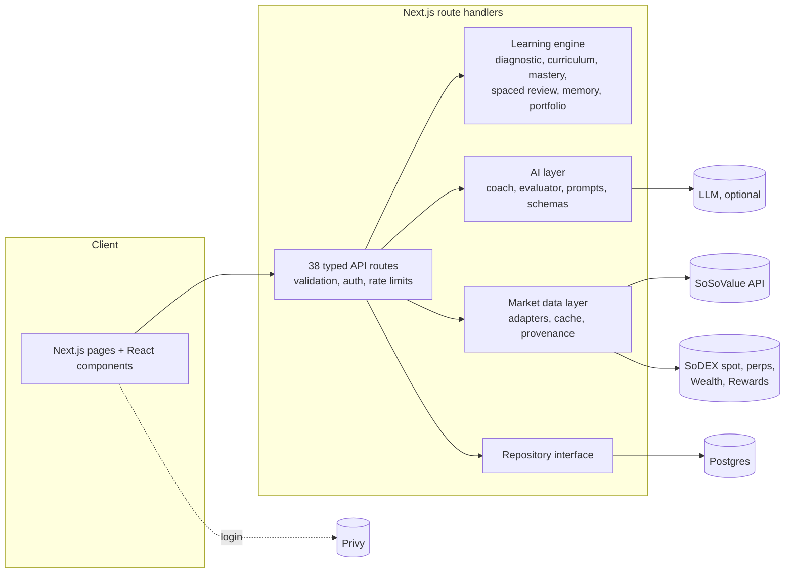

# MarketGym

**Train your market judgement with real data.**

MarketGym is an AI market-literacy coach built on the SoSoValue stack. It turns live SoSoValue market data and SoDEX order books, funds and reward data into graded analysis challenges, so people learn to read markets and prove they can.

**Live demo:** https://marketgym-henna.vercel.app
**Buildathon:** SoSoValue Buildathon (AKINDO)

> A news app tells you what happened. A trading app lets you trade. A chatbot explains a term.
> MarketGym gives you the evidence, makes you write the analysis, and grades it.

It is education only: no wallet, no deposits, no orders, no investment advice.

---

## Contents

- [The problem](#the-problem)
- [What it does](#what-it-does)
- [From data input to actionable output](#from-data-input-to-actionable-output)
- [SoSoValue API integration](#sosovalue-api-integration)
- [SoDEX API integration](#sodex-api-integration)
- [AI design](#ai-design)
- [Architecture](#architecture)
- [Tech stack](#tech-stack)
- [Security and risk controls](#security-and-risk-controls)
- [Testing](#testing)
- [Run it locally](#run-it-locally)
- [Deployment](#deployment)
- [Wave changelog](#wave-changelog)
- [Known limitations](#known-limitations)

---

## The problem

People follow markets through headlines and trading apps. They pick up the words (liquidity, ETF inflows, order book depth) without learning what the data shows, or what it cannot show.

- "ETF inflows hit a record" gets read as "price will go up". Flows do not prove that.
- Courses measure completion, not skill.
- Chatbots explain but never check understanding, and can invent figures.
- Trading rewards inflate volume, and learners read that volume as demand.

## What it does

One loop per skill: **diagnose → learn → practise → evaluate → improve → retain.**

| Screen | What the learner does | Data behind it |
|---|---|---|
| **Onboarding diagnostic** | 7 questions set the starting point | Curriculum |
| **Learning path** | 7 modules, 43 skills, prerequisites and locks | Stored mastery records |
| **AI coach** | Socratic tutor: one question at a time, 3 graduated hints | Lesson content + live evidence |
| **Scenario lab** | Reads a timestamped evidence pack, writes an analysis, gets a 100-point graded result | SoSoValue + SoDEX |
| **Order book gym** | Works out spread, depth, imbalance; compares ANT spot vs ANT perps | SoDEX spot + perps books |
| **Wealth lab** | Compares tokenised ETFs, vaults and the ANT Believers Index; reads SoDEX's DCA simulation; studies reward rules | SoDEX Wealth + Rewards |
| **Practice portfolio** | Builds a paper portfolio, gets a computed risk analysis, defends it in writing, gets graded | SoDEX Wealth |
| **Progress / skill passport** | Mastery per skill, attempts, repeated misconceptions, review schedule | Stored records |

Curriculum: **7 modules, 43 skills, 46 tracked misconceptions, 35 knowledge checks, 25 exercise templates**: markets, news, ETF data, indexes, order books, market reasoning, wealth and yield.

## From data input to actionable output

```
SoSoValue + SoDEX data ──► frozen, timestamped evidence pack ──► learner's written analysis
        ──► rubric grading (rules + AI) ──► named gaps and misconceptions
        ──► mastery update ──► next recommended mission ──► spaced review
```

The actionable output is specific: a score on four dimensions, the evidence you missed, the misconception you showed, and the exact next exercise chosen to fix it.

Grading rubric (every exercise): factual correctness **35**, evidence selection **25**, reasoning quality **25**, uncertainty and limits **15**.

Mastery is earned, not given: two scores of 80+ on different scenarios, a passed retention review, and no unresolved critical misconception.

---

## SoSoValue API integration

Base URL `https://openapi.sosovalue.com/openapi/v1`, header `x-soso-api-key`. Server-side only; the key never reaches the browser. **Verified against live responses.**

| Endpoint | Used for |
|---|---|
| `GET /currencies` | Resolve BTC/ETH currency ids at runtime |
| `GET /currencies/{id}/market-snapshot` | Price, 24h change, volume, market cap in scenario evidence |
| `GET /market/overview` | Market-wide context |
| `GET /etfs/summary-history?symbol=BTC\|ETH&country_code=US` | Spot ETF net inflow, cumulative inflow, total net assets (ETF module) |
| `GET /indices` | SSI index list |
| `GET /indices/{ticker}/constituents` | Index weights (concentration lessons) |
| `GET /indices/{ticker}/market-snapshot` | Index value and returns |
| `GET /news/pick` | News evidence for the "reading financial news" module |

Handling: every response is schema-validated (Zod) and normalised; a token bucket keeps usage under the 20 requests/minute limit; caching (snapshots 2 min, ETF 15 min, indexes and news 10 min); news HTML is stripped to text and treated as untrusted content.

Code: `lib/market-data/sosovalue/`.

## SoDEX API integration

Gateway `https://mainnet-gw.sodex.dev`. Public market data only, behind an explicit allow-list (`lib/market-data/sodex/allow-list.ts`). **Verified live.**

| API | Endpoints | Used for |
|---|---|---|
| **Spot** | `/api/v1/spot/markets/symbols`, `/markets/{symbol}/orderbook`, `/markets/tickers` | Order book gym: BTC, ETH and ANT books, tick and lot size |
| **Perps** | `/api/v1/perps/markets/symbols`, `/markets/{symbol}/orderbook` | ANT-USD perpetual book; the spot-vs-perps exercise |
| **Wealth** | `/api/v1/wealth/funds`, `/funds/{id}`, `/markets`, `/funds/{id}/price-history`, `/funds/{id}/dca-history` | Wealth lab and practice portfolio: tokenised ETFs (vQQQ, vVOO, ...), vaults, ANT Believers Index, DCA simulation |
| **Rewards** | `/api/v1/sopoints/volume-weights`, `/sopoints/week/info`, `/api/v1/lottery/meta`, `/lottery/feed` | "Incentives distort volume" lessons: points multipliers, reward-box rules, survivorship bias in the wins feed |

MarketGym never calls order, deposit, redemption, claim or signing endpoints. The allow-list rejects them even if a bug tried.

Code: `lib/market-data/sodex/`, `lib/market-data/services.ts`.

### Data honesty

Every data card shows its provider, time, and one of three states:

- **Live**: fetched for this request
- **Cached**: an earlier fetch, with its age
- **Demo**: a fixed sample, never shown as real-time

Scenarios freeze their evidence when created, so the facts cannot change while a learner is answering. Implausible provider values (for example a 7-day APY in the millions of percent) are shown in full with an "Unusual value, check the source" note, not hidden or altered.

---

## AI design

Separate services, not one agent:

| Service | Role | Uses a model? |
|---|---|---|
| Diagnostic | Places the learner | Rules; model only for the one open answer |
| Curriculum engine | Picks the next mission from prerequisites, mastery, overdue reviews, recurring misconceptions | No |
| Scenario generator | Template + frozen evidence pack | No |
| Coach | Socratic turn with citations | Yes (scripted fallback) |
| Evaluator | Rules grader always runs; model adds semantic scoring | Yes (rules-only fallback) |
| Mastery, spaced review, memory | Computed from stored records | No |
| Portfolio analysis | Concentration (HHI), fees, market-hours share, weighted returns | No |

Guardrails:

- Model output is validated against a strict schema before use and can never write mastery directly.
- The model's factual and evidence scores are capped near the rules score, so a confident answer that cites nothing cannot score highly.
- News and learner text are wrapped as untrusted content.
- No buy or sell advice, no promised returns, no invented figures.
- Without a model key, the app runs a scripted coach and rules-only grading and tells the learner so.

---

## Architecture



Design choices:

- **Provider adapters, normalised types.** The UI and AI never see raw provider payloads, only `lib/types` shapes that all carry `DataProvenance`.
- **One repository interface, three implementations** (`lib/db/repository.ts`): Postgres (production), Supabase, and a local JSON file. Routes and services are written once against the interface; the implementation is chosen at runtime from configuration.
- **One auth boundary, three modes** (`lib/auth/session.ts`): Privy, Supabase Auth, local demo. Every route calls the same `requireUser()`.
- **Live → cached → demo fallback** in every data service, always labelled.
- **Frozen contracts** in `docs/CONTRACTS.md` and `lib/types/`.

Repository layout:

```
app/            pages (marketing, auth, platform) and API routes
components/     UI primitives and feature components
lib/ai/         coach, evaluators, prompts, schemas
lib/learning/   diagnostic, curriculum engine, mastery, review, portfolio
lib/curriculum/ the 7-module track (content, rubrics, misconceptions)
lib/market-data SoSoValue + SoDEX adapters, cache, evidence packs
lib/db/         repository interface + Postgres, Supabase, local
lib/auth/       Privy verification, sessions
docs/           product, UX, design system, architecture, contracts, security, tests
tests/          unit, API, security, end-to-end
```

More detail: [`docs/ARCHITECTURE.md`](docs/ARCHITECTURE.md), [`docs/CONTRACTS.md`](docs/CONTRACTS.md), [`docs/PRODUCT_SPEC.md`](docs/PRODUCT_SPEC.md), [`docs/UX_SPEC.md`](docs/UX_SPEC.md), [`docs/DESIGN_SYSTEM.md`](docs/DESIGN_SYSTEM.md), [`docs/SECURITY.md`](docs/SECURITY.md), [`docs/TEST_PLAN.md`](docs/TEST_PLAN.md), [`docs/research/SOSOVALUE.md`](docs/research/SOSOVALUE.md), [`docs/research/SODEX.md`](docs/research/SODEX.md).

## Tech stack

| Layer | Technology |
|---|---|
| Framework | Next.js 16 (App Router), React 19, TypeScript (strict) |
| UI | Tailwind CSS 4, Radix UI, Framer Motion, Recharts, EasyUI-derived components |
| Validation | Zod 4 on every request, external response and model output |
| Auth | Privy (email + Google); own signed session cookie |
| Database | Postgres (Supabase-hosted), isolated schema |
| AI | OpenAI structured outputs behind a provider layer; rules-based fallback |
| Data | SoSoValue OpenAPI; SoDEX spot, perps, Wealth and Rewards APIs |
| Testing | Vitest, Playwright, axe |
| Hosting | Vercel |

## Security and risk controls

- **No trading surface.** No wallet connection, no order, deposit or claim code. SoDEX access is a read-only allow-list.
- **Secrets stay on the server.** API keys are read in one module and never bundled to the client.
- **Per-user isolation.** Every query filters by the signed-in user; database tables are closed to direct access.
- **Sessions.** httpOnly, SameSite cookie; Privy tokens verified against Privy's public keys; sign-out revokes server-side.
- **Rate limits** on market, coach, grading and diagnostic routes.
- **Security headers:** frame-ancestors none, nosniff, HSTS, referrer policy.
- **Prompt-injection handling.** News and learner text are untrusted; model output is schema-checked and cannot change progress directly.
- **Independent audit pass** with fixes: see [`docs/SECURITY.md`](docs/SECURITY.md).

## Testing

| Suite | Command | Result |
|---|---|---|
| Typecheck | `pnpm typecheck` | 0 errors |
| Lint | `pnpm lint` | clean |
| Unit, API, security | `pnpm test` | 590 / 590 |
| End-to-end (desktop + mobile, accessibility) | `pnpm test:e2e` | 16 / 16 on the core journey |
| Production build | `pnpm build` | passing |

## Run it locally

Requirements: Node 20+, pnpm 9+.

```bash
pnpm install
cp .env.example .env.local   # optional: the app runs with an empty file
pnpm dev                     # http://localhost:3000
```

With nothing configured it runs in local mode: one demo learner, live SoDEX data, labelled demo data for SoSoValue, and the rules-based coach and grader.

| Variable | Effect |
|---|---|
| `SOSOVALUE_API_KEY` | Live SoSoValue prices, ETF flows, indexes and news |
| `NEXT_PUBLIC_PRIVY_APP_ID`, `DATABASE_URL`, `SESSION_SECRET`, `DB_SCHEMA` | Privy login and Postgres storage |
| `OPENAI_API_KEY`, `OPENAI_MODEL` | Model-backed coach and semantic grading |
| `DEMO_MODE=true` | Never call external APIs; everything labelled demo |

## Deployment

Vercel + Postgres. Set the variables above; tables are created automatically in their own schema on first use.

## Wave changelog

**This wave**

- SoSoValue integration verified against live data (prices, market overview, ETF flows, indexes, news).
- SoDEX integration extended from spot order books to **perps, Wealth and Rewards** APIs.
- New **Wealth lab**: tokenised ETFs, vaults, ANT Believers Index, price history, SoDEX DCA simulation, reward rules.
- New **Practice portfolio**: paper portfolio with computed risk analysis and a graded written rationale.
- Order book gym: ANT/USDC spot and ANT-USD perpetual, with a spot-vs-perps exercise.
- New curriculum module "Wealth and yield" plus trading hours, spot vs perps and index NAV skills (43 skills, 46 misconceptions).
- Privy login, Postgres storage, public deployment.
- Frontend polish: product-led landing page, motion, animated numbers, command menu.
- Security audit and fixes.

## Known limitations

- The model-backed coach and grader need an OpenAI key; without one the scripted coach and rules grader run and say so.
- SoDEX serves its DCA simulation for 1 and 3 years only; the 3- and 6-month views are computed by MarketGym from SoDEX daily prices with the same weekly method, and are labelled as computed.
- Cache and rate limiter are per server instance.
- End-to-end tests cover the core journey; the Wealth lab and portfolio screens are covered by unit and API tests.
